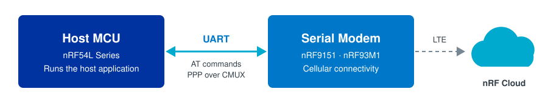

# Serial Modem Host Applications

Host-side firmware for Nordic Smart Modem modules. The applications in this repository run on a host MCU, use a Serial Modem for cellular connectivity, and send data to nRF Cloud. They are built on [nRF Connect SDK](https://www.nordicsemi.com/Products/Development-software/nRF-Connect-SDK) and share the modular **zbus + SMF** architecture of the [Asset Tracker Template](https://github.com/nrfconnect/Asset-Tracker-Template).

## Applications

| Your hardware | Application | What it does |
|---------------|-------------|--------------|
| nRF54L15 DK or nRF54LM20B DK, wired to an nRF9151 DK | [PPP Host Application](docs/applications/ppp/README.md) | The host connects to nRF Cloud over its own IP stack, with the modem carrying IP over PPP. Includes FOTA, remote debugging, and optional Wi-Fi location. |
| nRF93M1 DK | [PPP Host Application](docs/applications/ppp/README.md) | The same application on the integrated nRF93M1 modem, with FOTA, remote debugging, cell and Wi-Fi location, and battery reporting. |
| nRF93M1 DK | [nRF93M1 AT Host Application](docs/applications/93m1_at/README.md) | A minimal host. The modem connects to nRF Cloud with its built-in client, and the host drives it with AT commands. |

## Get started

**[Getting started](docs/getting-started/index.md)** takes you from choosing your application to a device sending data to nRF Cloud, using the command line.

## License

See [LICENSE](LICENSE).
