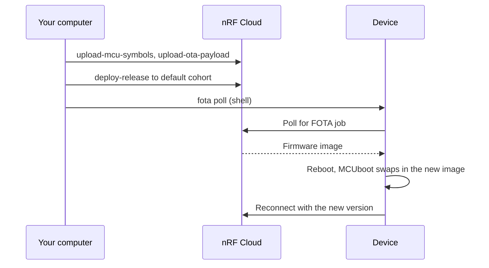

# Application FOTA

This page describes how to update the host application firmware over the air (FOTA) on the [PPP Host Application](applications/ppp/README.md) from the command line. You publish the update to nRF Cloud with the [`memfault` CLI](https://docs.memfault.com/docs/ci/install-memfault-cli), and the device fetches it from nRF Cloud over its existing CoAP session.



## Prerequisites

To follow this guide, you must meet the following requirements:

- A device that is provisioned, onboarded to nRF Cloud, and logs `Cloud connected`. See the getting-started guide for [an nRF54 DK](getting-started/ppp-nrf54.md) or [the nRF93M1 DK](getting-started/ppp-nrf93m1.md).
- The `memfault` CLI for nRF Cloud: `pip3 install memfault-cli`.
- An organization auth token and the organization and project slugs. Login to nRF Cloud then go to **Admin** > **Organization Auth Tokens** to generate one.

## Release parameters

The CLI needs the following values for the build:

| Application | Board | `--software-type` | `--hardware-version` |
|-------------|-------|-------------------|----------------------|
| `ppp` | `nrf54l15dk/nrf54l15/cpuapp/ns` | `smha-91m1` | `nrf54l15dk` |
| `ppp` | `nrf54lm20dk/nrf54lm20b/cpuapp/ns` | `smha-91m1` | `smha-nrf54lm20dk` |
| `ppp` | `nrf93m1dk/nrf54l15/cpuapp/ns` | `smha-93m1` | `smha-nrf93m1dk` |

`--software-version` is the version the update image reports. It comes from the application's [`VERSION`](https://github.com/nrfconnect/ncs-serial-modem-host-applications/blob/main/applications/ppp/VERSION) file, in the format `MAJOR.MINOR.PATCH+TWEAK`. For example, `1.0.1+0`. The update must have a higher version than the firmware running on the device. To read the exact value from a build, run the following command:

```shell
grep CONFIG_MEMFAULT_NCS_FW_VERSION= build/<app>/zephyr/.config
```

## Steps

The examples use the nRF93M1 DK, updating from `1.0.0` to `1.0.1`. For the nRF54 host DKs, change the board and parameters from the table above.

### 1. Build the update image

Starting from the firmware that runs on the device, bump the version in `applications/ppp/VERSION`:

```text
VERSION_MAJOR = 1
VERSION_MINOR = 0
PATCHLEVEL = 1
VERSION_TWEAK = 0
EXTRAVERSION =
```

Then build it. Do not flash this image.

```shell
cd applications/ppp
west build -p -b nrf93m1dk/nrf54l15/cpuapp/ns
```

The build produces the following files:

- `build/ppp/zephyr/zephyr.signed.bin` - The signed MCUboot image, which is the OTA payload.
- `build/ppp/zephyr/zephyr.elf` - The symbol file, used to decode crash reports from the new image.

### 2. Publish and deploy the release

Set the credentials from the [prerequisites](#prerequisites) as environment variables:

```shell
export MEMFAULT_ORG_TOKEN=<org_auth_token>
export MEMFAULT_ORG=<org_slug>
export MEMFAULT_PROJECT=<project_slug>
```

Upload the symbol file:

```shell
memfault --org-token $MEMFAULT_ORG_TOKEN --org $MEMFAULT_ORG --project $MEMFAULT_PROJECT \
    upload-mcu-symbols build/ppp/zephyr/zephyr.elf
```

Upload the OTA payload, which creates release `1.0.1+0`:

```shell
memfault --org-token $MEMFAULT_ORG_TOKEN --org $MEMFAULT_ORG --project $MEMFAULT_PROJECT \
    upload-ota-payload \
    --hardware-version smha-nrf93m1dk \
    --software-type smha-93m1 \
    --software-version 1.0.1+0 \
    build/ppp/zephyr/zephyr.signed.bin
```

Deploy the release to the `default` cohort:

```shell
memfault --org-token $MEMFAULT_ORG_TOKEN --org $MEMFAULT_ORG --project $MEMFAULT_PROJECT \
    deploy-release --release-version 1.0.1+0 --cohort default
```

To update only part of the cohort, add `--rollout-percent` to `deploy-release`. See the [`deploy-release`](https://docs.memfault.com/docs/ci/cli/deploy-release) reference for more information.

### 3. Trigger the update

The device checks for updates on its own once per cloud sync interval. To start the update right away, run the following command in the host shell:

```shell
uart:~$ fota poll
```

The following log shows that the download has started:

```text
<inf> main: FOTA download starting
```

nRF Cloud can take up to a minute to offer a newly deployed release. If the poll finds no update (the application logs `No FOTA update available`), wait a little and run `fota poll` again.

### 4. Wait for the device to reboot

```text
<inf> main: FOTA successful, rebooting to apply the update
```

MCUboot swaps in the new image. The device then reconnects (`Cloud connected`) and confirms the image, so MCUboot keeps it on later boots.

### 5. Verify the version

Run the following command in the host shell:

```shell
uart:~$ mflt get_device_info
```

The software version must be `1.0.1+0`. The device also shows the new version in nRF Cloud after its next upload.

### 6. Deactivate the release when testing

While a release is deployed, it is offered to every device in the cohort that runs an older version.

```shell
memfault --org-token $MEMFAULT_ORG_TOKEN --org $MEMFAULT_ORG --project $MEMFAULT_PROJECT \
    deploy-release --release-version 1.0.1+0 --cohort default --deactivate
```
