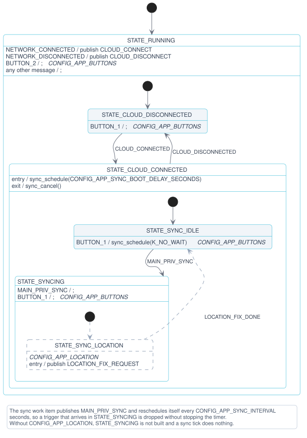
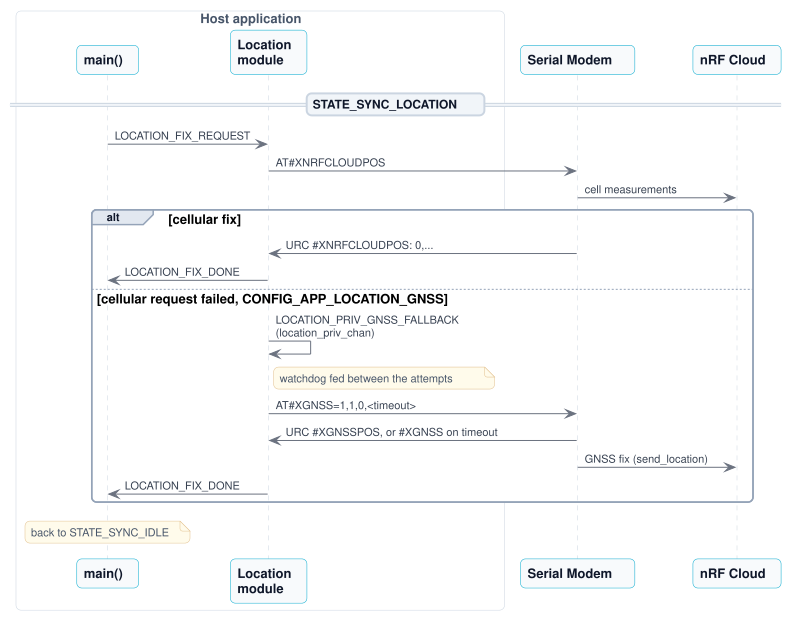

# nRF91 AT Host Application

Minimal location tracker for an **nRF91 Series Serial Modem**. The host runs no IP stack. It drives the [Serial Modem](https://github.com/nrfconnect/ncs-serial-modem) with AT commands over a single UART, and the Serial Modem does all communication with nRF Cloud:

- **Onboarding:** the Serial Modem's nRF Cloud provisioning client (`AT#XNRFPROV`) installs the nRF Cloud credentials in the modem once the device is claimed. No credentials are stored on the host.
- **Connection:** the Serial Modem's nRF Cloud CoAP client (`AT#XNRFCLOUD`).
- **Location:** neighbour-cell positioning through nRF Cloud (`AT#XNRFCLOUDPOS`), with a GNSS fix using nRF Cloud A-GNSS (`AT#XGNSS`) as a fallback.

The host does not use PPP. With PPP running, the Serial Modem hands all downlink data on the default PDN to the PPP link, and its own nRF Cloud client could not work.

> [!TIP]
> New here? Follow [Get started with the nRF91 AT Host Application](../../getting-started/91m1-at.md) to wire, build, flash, claim the device in nRF Cloud, and verify that location fixes arrive. This page is the reference for the application.

## Supported hardware

| Hardware | Board target | Host console |
|----------|--------------|--------------|
| nRF54LM20B DK wired to an nRF9151 DK running Serial Modem | `nrf54lm20dk/nrf54lm20b/cpuapp/ns` | VCOM0 (`uart30`) |

The Serial Modem link uses `uart21` with hardware flow control, DTR (P1.11) and nRESET (P1.10), with the same wiring as the [PPP Host Application](../../getting-started/ppp-nrf54.md#34-wire-the-dks-together). The host pulses nRESET at boot and keeps DTR asserted, so the Serial Modem UART stays enabled.

## Modules

The application follows the shared [Architecture](../../architecture.md). See [Modules per application](../../architecture.md#modules-per-application) for what each one does in this application.

| Module | Role |
|--------|------|
| Main | Asks the Cloud module to connect when the network is up, and runs the cloud synchronization while the cloud is connected. |
| Network | Configures the Serial Modem at boot (`AT+CEREG=5`, LTE-M, NB-IoT and GNSS system mode), brings LTE up with `AT+CFUN=1`, and reports the registration state from `+CEREG`. |
| Cloud | On Main's request, onboards the device with `AT#XNRFPROV`, then connects the Serial Modem's nRF Cloud client. |
| Location | Requests a cellular fix, and runs GNSS if that fails. |
| Buttons | Publishes DK button presses. |
| Modem AT | Owns the UART, serializes AT commands from the modules and the shell, and routes URCs to the modules. |
| Modem Power | Applies the modem power saving settings each time the network connects. |

## Provisioning

On every boot, once LTE is registered, Main sends `CLOUD_CONNECT` and the Cloud module runs a provisioning session:

1. The module sends `AT#XNRFPROV`. The Serial Modem connects to the nRF Cloud provisioning service.
1. If the service has credentials to install, the Serial Modem reports `#XNRFPROV: 1`. The host takes LTE offline with `AT+CFUN=4` while the credentials are written, and brings it back with `AT+CFUN=1` on `#XNRFPROV: 2`.
1. `#XNRFPROV: 0` ends the session. The console logs `Provisioning done`, and the module connects with `AT#XNRFCLOUD=1,1`. When the device is already provisioned, the session ends right away with no commands.
1. If the device is not claimed, the Serial Modem reports `#XNRFPROV: -2`. The console logs the attestation token from `AT%ATTESTTOKEN`, and the module retries every `CONFIG_APP_CLOUD_RETRY_SECONDS` (60 s) until you claim the device.

The nRF Cloud device ID is the modem UUID, which the console logs as `Device UUID:`.

The Cloud module reports `CLOUD_CONNECTED` once the Serial Modem's nRF Cloud client is connected. When the network goes down, Main sends `CLOUD_DISCONNECT`, and the module reports `CLOUD_DISCONNECTED`. The Serial Modem keeps its nRF Cloud session, so the next connect reuses it if it is still up. The `CLOUD_DISCONNECT` that follows `AT+CFUN=4` during provisioning is ignored.

## Cloud synchronization

Once the cloud is connected, Main runs a cloud sync 5 seconds later and then every 10 minutes (`CONFIG_APP_SYNC_BOOT_DELAY_SECONDS` and `CONFIG_APP_SYNC_INTERVAL`). Each sync requests a location fix with `LOCATION_FIX_REQUEST`, and Main waits for `LOCATION_FIX_DONE`, whether a fix was found or not, before it accepts the next trigger.

The Main module tracks this with a hierarchical state machine. See [Diagram notation](../../architecture.md#diagram-notation) for how to read the diagram:



A sync interval or a **Button 1** press that arrives while a sync is running is skipped. A cloud disconnect cancels the sync timer.

## Location

Each sync sends `AT#XNRFCLOUDPOS=4,0`. The Serial Modem measures up to four cells, nRF Cloud resolves them, and the console logs the result:

```text
<inf> location: Location: 63.420824,10.443289 Uncertainty: 344m Method: Multicell
```

If the cellular request fails, the module publishes `LOCATION_PRIV_GNSS_FALLBACK` on its private channel and starts a single GNSS fix with A-GNSS (`AT#XGNSS=1,1,0,120`). The cloud module connects with `<send_location>` set, so the Serial Modem sends the GNSS fix to nRF Cloud itself. GNSS only runs while LTE is idle, which PSM provides. Before the first fix, the module sends `CONFIG_APP_LOCATION_GNSS_ANTENNA_CMD` (`AT%XCOEX0=1,1,1565,1586` by default), which enables the onboard GNSS antenna of the nRF9151 DK. The module publishes `LOCATION_FIX_DONE` after the GNSS attempt, or right after the cellular fix when that succeeds:



| Option | Default | Description |
|--------|---------|-------------|
| `CONFIG_APP_LOCATION_CELL_COUNT` | 4 | Cells in a cellular request. 1 gives single-cell positioning. |
| `CONFIG_APP_LOCATION_GNSS` | y | Fall back to GNSS. |
| `CONFIG_APP_LOCATION_GNSS_TIMEOUT_SECONDS` | 120 | GNSS fix timeout. |
| `CONFIG_APP_SYNC_INTERVAL` | 600 | Seconds between syncs. |

## Modem power saving

Each time the network connects, the Modem Power module applies the modem power saving settings (`CONFIG_APP_MODEM_POWER`):

- PSM is requested with `AT+CPSMS`. The defaults ask for a 12 hour TAU and a 4 second active time (`CONFIG_APP_MODEM_POWER_PSM_TAU`, `CONFIG_APP_MODEM_POWER_PSM_ACTIVE_TIME`), and the network decides the granted values. PSM also gives the GNSS fallback time to run while LTE is idle.
- Proprietary PSM is enabled with `AT%FEACONF=0,0,1`, so the modem sleeps like in PSM when the network does not grant it. The device must then always start the data exchange, as the network cannot reach it while it sleeps.

## Shell commands

| Command | Action |
| --- | --- |
| `at "<command>"` | Send an AT command to the Serial Modem and print the response. |
| `network connect` / `network disconnect` | Bring LTE up (`AT+CFUN=1`) or down (`AT+CFUN=4`). |
| `button 1` / `button 2` | Simulate a press of the matching DK button. |

Pressing **Button 1** (or running `button 1`) starts a sync right away instead of waiting for the next interval.

## Troubleshooting

| Symptom | Meaning |
| --- | --- |
| `network: Serial Modem did not respond within 30 s` | The host gets no answer on `uart21`. Check the wiring, the matching VDD on both DKs, and that the nRF9151 DK runs Serial Modem firmware. |
| `cloud: Device not claimed, claim it in nRF Cloud with the attestation token` | Claim the device with the logged token, as described in [Connect to nRF Cloud](../../getting-started/91m1-at.md#step-5-connect-to-nrf-cloud). The module retries every 60 seconds. |
| `cloud: Failed to connect to nRF Cloud` | The Serial Modem could not connect to nRF Cloud. The module retries every 60 seconds. |
| `location: GNSS timed out without a fix` | The GNSS fallback got no fix. GNSS needs a clear view of the sky. |
