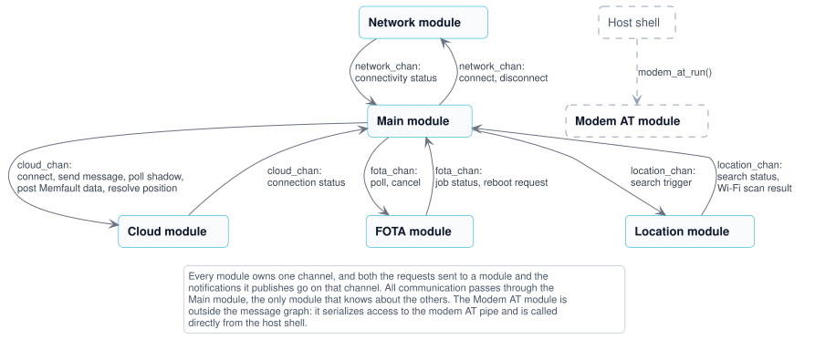

# nRF91M1 PPP Host Application

The [nRF91M1 PPP Host Application](https://github.com/nrfconnect/ncs-serial-modem-host-applications/blob/main/applications/91m1_ppp/) runs on an nRF54L15 DK or nRF54LM20B DK wired to an nRF9151 DK running the Serial Modem firmware. Cellular data goes through the Serial Modem over PPP, and the host connects to nRF Cloud over **CoAP/DTLS** itself. The host stores its nRF Cloud credentials with the TLS credentials shell in TF-M Protected Storage.

> [!TIP]
> New here? Follow [Get started with the nRF91M1 PPP Host Application](../../getting-started/91m1-ppp.md) to set up the hardware, build, flash, and connect to nRF Cloud. This page is the reference for the application.

## Supported hardware

| Host setup | Board target | Host console |
|------------|--------------|--------------|
| nRF54L15 DK + nRF9151 DK | `nrf54l15dk/nrf54l15/cpuapp/ns` | VCOM1 |
| nRF54LM20B DK + nRF9151 DK | `nrf54lm20dk/nrf54lm20b/cpuapp/ns` | VCOM0 |
| nRF54LM20B DK + nRF7002-EB II + nRF9151 DK (Wi-Fi® location) | `nrf54lm20dk/nrf54lm20b/cpuapp/ns` with the location overlay | VCOM0 |

The nRF9151 SMA DK can replace the nRF9151 DK in every setup. See the [Hardware reference](hardware-setup.md) for the Board Configurator settings, pinout, and devicetree overlays.

## Modules

The application follows the shared [Architecture](../../architecture.md). It consists of the following modules:

- **[Main module](modules/main.md)**: Implements the business logic and controls the overall application behavior. Uniquely, it is not in the `modules` folder.
- **[Network module](modules/network.md)**: Brings the PPP link to the Serial Modem up and down, and tracks connectivity status.
- **[Cloud module](modules/cloud.md)**: Handles communication with nRF Cloud using CoAP.
- **[FOTA module](modules/fota.md)**: Manages firmware over-the-air updates of the host application.
- **[Location module](modules/location.md)**: Provides Wi-Fi based positioning. Only built with the location overlay.
- **Modem AT module**: Serializes access to the modem AT pipe behind `modem_at_run()`. It is the one module that has no zbus channel and no state machine and is called directly from the host shell. See [Reaching Serial Modem AT commands](#reaching-serial-modem-at-commands).

The following diagram shows how the modules interact. Each module owns one channel, and both the requests sent to a module and the notifications it publishes go on that channel.



The following steps show the simplified flow of a typical operation:

1. The Network module connects on startup, and publishes `NETWORK_CONNECTED` on the `network_chan` channel once the PPP link carries IP traffic.
1. The Main module responds by requesting a cloud connection with `CLOUD_CONNECT` on the `cloud_chan` channel. The Cloud module waits for valid time and installed credentials, connects to nRF Cloud, and publishes `CLOUD_CONNECTED`.
1. While the cloud connection is up, the Main module runs a periodic **cloud synchronization**: it sends a device message, triggers a location search, polls the device shadow, requests a FOTA poll, and posts pending Memfault data.
1. A location search runs asynchronously. The Location module scans for Wi-Fi access points and publishes the result as `LOCATION_CLOUD_REQUEST`, which the Main module forwards to the Cloud module for resolution by the nRF Cloud location service.
1. If the FOTA poll finds a job, the FOTA module downloads the update and asks the Main module to reboot with `FOTA_REBOOT_REQUEST`.

See [Application behavior](application-behavior.md) for the full startup sequence, cloud synchronization, and configuration options.

## Credentials explained

The host authenticates to nRF Cloud with a JWT signed with its private key. Only the **CA certificate** and **private key** are required at runtime. The device certificate is used to onboard the device in nRF Cloud. The default nRF Cloud security tag is **16842753** (`CONFIG_NRF_CLOUD_SEC_TAG`).

The Device ID is a 16-character hex ID derived from the host SoC hardware ID (`CONFIG_NRF_CLOUD_CLIENT_ID_SRC_HW_ID`). It is not the nRF91 modem UUID.

The `device_credentials_installer` options used in the getting-started guides do the following:

- `--id-str <device_id>` sets the Device ID from the boot log.
- `--coap` installs the CoAP server root CA in addition to the AWS root CA chain.
- `--local-cert` generates the device certificate and private key on your computer. This is required because the TLS credentials shell does not support CSR generation.
- `--cmd-type tls_cred_shell` sends `cred` shell commands over the host UART.
- `-s` saves the generated PEM files (`<device_id>_crt.pem`, `<device_id>_prv.pem`, and so on) in the current directory.
- `-d` deletes any existing credentials in sec tag 16842753 before installing the new ones.
- `--verify` confirms the credentials were written correctly.
- `--port` selects the host console serial port. Omit it if auto-detection works.

Credentials persist across reboots and plain re-flashes when `CONFIG_TLS_CREDENTIALS_BACKEND_PROTECTED_STORAGE` is enabled. `west flash --recover`, `west flash --erase`, and `nrfutil device recover` wipe them.

See the [nRF Cloud Utils](https://github.com/nRFCloud/utils) repository for all options.

## Memfault

The application includes Memfault for remote crash reporting and device health metrics. The SDK uploads data periodically in the background (`CONFIG_MEMFAULT_PERIODIC_UPLOAD`) over the nRF Cloud CoAP session.

See [Memfault remote debugging](memfault.md) for how to open the Memfault dashboard from nRF Cloud, upload `zephyr.elf`, and verify data collection.

## Troubleshooting

| Symptom | Action |
|---------|--------|
| `init_chat_script: timed out` | The modem is not answering. Check that the nRF9151 DK runs the `nrf91m1` Serial Modem variant, that VCOM0 **and** VCOM0 HWFC are disconnected on the nRF9151 DK, and that the TX/RX and RTS/CTS pairs cross. See the [getting-started guide](../../getting-started/91m1-ppp.md#step-1-set-up-the-hardware). |
| `Missing nRF Cloud credentials` | Re-run `device_credentials_installer` with `--coap --cmd-type tls_cred_shell`. |
| `nrf_cloud_coap_connect` auth failure | Confirm the device is onboarded in the portal with the correct device ID. |
| Wrong device in portal | Use the host **Device ID** from boot log, not the modem `%DEVICEUUID`. |
| JWT / time errors | After `Network connected`, run `net dns query time.google.com`. Ping to an IP does not prove DNS works. If logs show `getaddrinfo entries overflow`, ensure `CONFIG_DNS_RESOLVER_AI_MAX_ENTRIES=4` is set. If SNTP fails with `Not enough connection contexts`, increase `CONFIG_NET_MAX_CONN` (IPv4-only builds default to `4`, which is too low once DNS, modem, SNTP, and CoAP are active simultaneously). |
| `nrf_cloud_coap_connect` error `-111` | Host-native CoAP needs DTLS sockets (`CONFIG_NET_SOCKETS_SOCKOPT_TLS`, `CONFIG_NET_SOCKETS_ENABLE_DTLS`). If enabling DTLS causes `RAM overflowed`, lower `CONFIG_MBEDTLS_SSL_IN/OUT_CONTENT_LEN` to 1024 (defaults are 16 KB each) and disable IPv6. Then run `net dns query coap.nrfcloud.com` after PPP is up. |
| `Failed to parse certificate` err `-0x2180` | Shell-provisioned credentials are PEM. Enable `CONFIG_MBEDTLS_PEM_PARSE_C=y` (see `nrf/samples/wifi/nrf_cloud/prj.conf`). Reinstall credentials if a prior install truncated them.|
| `Failed to parse certificate` err `-0xffffffff` | mbedTLS returned `1`: one cert in the CA chain or device cert failed to parse. Enable `CONFIG_MBEDTLS_RSA_C`, `CONFIG_MBEDTLS_ECP_C`, and `CONFIG_PSA_WANT_ALG_ECDH` (see `nrf/samples/wifi/nrf_cloud/prj.conf`). |
| `RAM overflowed` with cloud enabled | Trim TLS buffers (`MBEDTLS_SSL_IN/OUT_CONTENT_LEN=1024`), disable `CONFIG_NET_IPV6`, and reduce `NET_PKT/BUF` counts before dropping DTLS. |
| FOTA download `Failed to create socket, errno 12` while cloud is connected | The CoAP cloud session and the FOTA CoAP downloader each need a DTLS context. Ensure `CONFIG_NET_SOCKETS_TLS_MAX_CONTEXTS` is at least **2** and increase `CONFIG_MBEDTLS_HEAP_SIZE` if needed (see `93m1_ppp/prj.conf`). |
| Boot loop (~6 s) | Usually a hard fault from stack overflow. Increase `CONFIG_APP_CLOUD_THREAD_STACK_SIZE` (default 10240) if cloud connect faults; keep `CONFIG_MODEM_DEDICATED_WORKQUEUE=y`. To capture the fault, temporarily set `CONFIG_RESET_ON_FATAL_ERROR=n` and check for `fatal_error: Resetting system` or stack traces. |
| `device_credentials_installer` cannot connect | Confirm the shell prompt (`uart:~$`) is visible on the selected serial port, and that no serial terminal has the port open. |
| Serial Modem console silent after its boot banners | Expected: Serial Modem suspends its log UART after init. Run `modem at "AT#XLOG=1"` to resume it (see the following section). |

### Reaching Serial Modem AT commands

`CONFIG_MODEM_AT_SHELL` exposes the modem's AT interface over the host shell using the CMUX user pipe, for Serial Modem commands that have no host-side equivalent:

```shell
uart:~$ modem at "AT#XLOG=1"
OK
```

This is how you get Serial Modem logs during operation. The modem prints its bootloader and application banners over VCOM1 at 1000000 baud and then suspends the log backend and the UART, so the console stays silent until `AT#XLOG=1` resumes it.

> [!NOTE]
> The pipe only exists once the modem has attached, CMUX runtime power save closes it again when idle (the command then answers `modem is not ready`, so retry), and any host reboot resets the modem and turns logging back off.

## Reference guides

| Guide | Description |
|-------|-------------|
| [Get started](../../getting-started/91m1-ppp.md) | Hardware setup, build and flash, cloud onboarding, and verification |
| [Application behavior](application-behavior.md) | Startup sequence, cloud sync, FOTA, and Memfault at runtime |
| [Architecture](../../architecture.md) | Module design, zbus message passing, and SMF state machines, shared by all applications |
| [Hardware reference](hardware-setup.md) | Board Configurator settings, Serial Modem pinout, and devicetree overlays |
| [Memfault remote debugging](memfault.md) | Open Memfault from nRF Cloud, upload symbol files, view coredumps |

Module documentation:

- [Main module](modules/main.md) — business logic, cloud synchronization, FOTA coordination
- [Network module](modules/network.md) — PPP link to the Serial Modem
- [Cloud module](modules/cloud.md) — nRF Cloud CoAP session, device messages, shadow
- [FOTA module](modules/fota.md) — firmware updates of the host application
- [Location module](modules/location.md) — Wi-Fi based positioning (location overlay)

## References

- [nRF Cloud CoAP library](https://docs.nordicsemi.com/bundle/ncs-latest/page/nrf/libraries/networking/nrf_cloud_coap.html)
- [nRF Cloud Utils](https://github.com/nRFCloud/utils)
