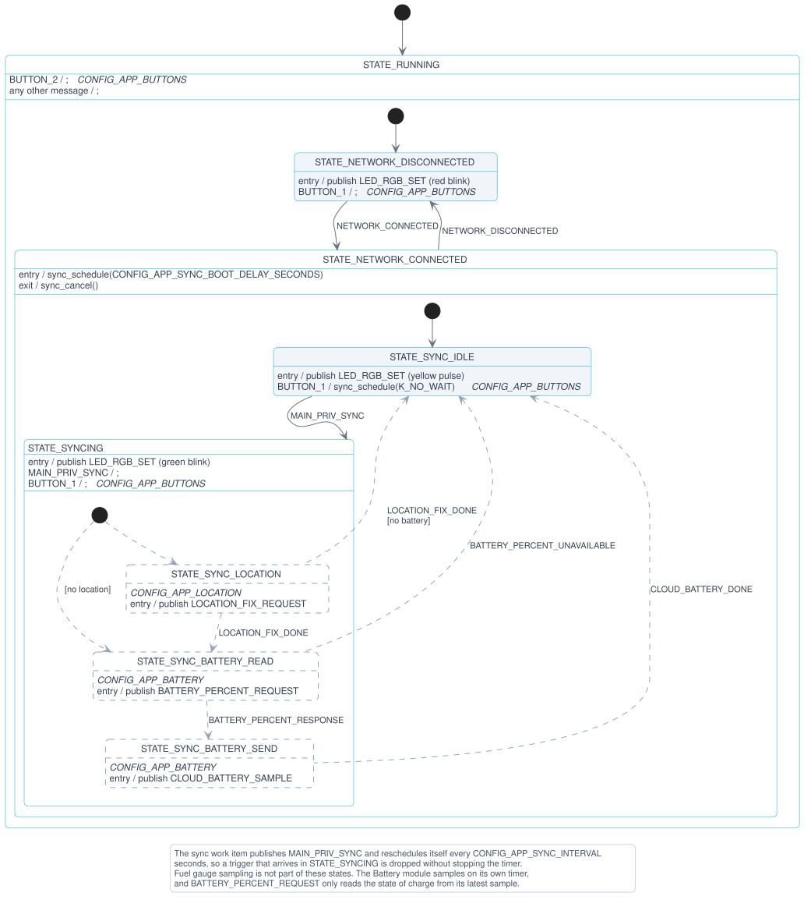
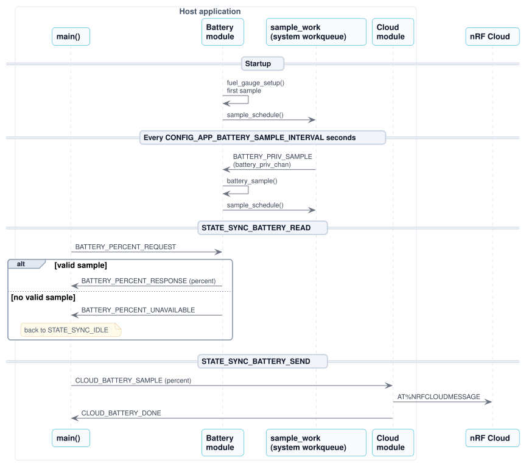

# nRF93M1 AT Host Application

Minimal tracker application for the **nRF93M1 Serial Modem**. The host runs Zephyr's cellular
modem driver, which dials the modem and brings up a PPP link over a CMUX channel. The application
uses this only for connectivity management: `conn_mgr` powers the link up and down, and the PPP
interface's L4 connected or disconnected events tell the application when the network is available.
The application sends no IP traffic of its own over PPP. All cloud communication (telemetry,
location, TLS) instead goes through the modem's own nRF Cloud client through raw AT commands over a
separate CMUX user pipe. The host samples the battery state locally and periodically syncs it and
location fixes to nRF Cloud over that AT interface.

> [!TIP]
> New here? Follow [Get started with the nRF93M1 AT Host Application](../../getting-started/93m1-at.md) to build, flash, claim the device in nRF Cloud, and verify that data arrives. This page is the reference for the application.

## Supported hardware

| Hardware | Board target | Host console |
|----------|--------------|--------------|
| nRF93M1 DK | `nrf93m1dk/nrf54l15/cpuapp/ns` | VCOM0 (`uart20`) |

## Modules

The application follows the shared [Architecture](../../architecture.md). It consists of the Main, Network, Cloud, Location, Battery, Buttons, LED, Modem AT, and Modem Power modules. See [Modules per application](../../architecture.md#modules-per-application) for what each one does in this application.

## Cloud synchronization

Once the modem has attached to the network, it performs a cloud sync five seconds after the network connects and then every 10 minutes. Set the delay and the period with `CONFIG_APP_SYNC_BOOT_DELAY_SECONDS` and `CONFIG_APP_SYNC_INTERVAL`. Each sync runs three steps in order through the modem's nRF Cloud client. The Main module waits for each step to finish, whether it succeeded or not, before it starts the next step:

- **Location:** Sends `AT%NRFCLOUDLOCATION=7,1`. The modem collects single-cell, multicell and Wi-Fi® measurements, nRF Cloud resolves them to a position, and the modem returns the result to the host. Change the method with `CONFIG_APP_LOCATION_METHOD` , which is a bitmask: 1 for single-cell, 2 for multicell, 4 for Wi-Fi, or a sum of these values.
- **Battery:** Asks the Battery module for the state of charge with `BATTERY_PERCENT_REQUEST`, then sends the answer as a device message: `{"appId":"BATTERY","messageType":"DATA","data":"<percent>"}`. The Battery module samples the fuel gauge on its own every 60 seconds, whether or not the device is connected (`CONFIG_APP_BATTERY_SAMPLE_INTERVAL`), and answers with the latest sample. If it has no valid sample, it answers `BATTERY_PERCENT_UNAVAILABLE`, and the application skips the step.
- **Observability:** Triggers a metrics heartbeat with `AT%NRFCLOUDOBSHEARTBEAT`, then uploads the observability chunks queued on the modem with `AT%NRFCLOUDOBSUPLOAD`. nRF Cloud lists the device as seen, with its hardware and software versions, once this data has arrived. The console logs the modem's result line, for example `%NRFCLOUDOBSUPLOAD: UPLOADED,2`. A failed heartbeat is only logged, and the upload runs anyway, because chunks that the modem queued earlier can still be uploaded. Set `CONFIG_APP_CLOUD_OBSERVABILITY_HEARTBEAT=n` to upload only what the modem has queued on its own, or `CONFIG_APP_CLOUD_OBSERVABILITY=n` to leave the step out. The modem documents the heartbeat command for debug use.

The Main module tracks the sync with a hierarchical state machine. Each step is a substate of `STATE_SYNCING`. The Main module enters a substate by publishing the request to the module that handles that step, and leaves the substate when that module publishes that it is done. The following diagram shows the state machine, and [Diagram notation](../../architecture.md#diagram-notation) explains how to read it:

The Battery module keeps its own sampling routine. A delayed work item publishes `BATTERY_PRIV_SAMPLE` on the module's private channel, and the module thread samples the fuel gauge and schedules the next tick. The Main module only talks to the Battery module over `battery_chan`, as the following diagram shows:

The application leaves out a step whose module or option is not built (`CONFIG_APP_LOCATION`, `CONFIG_APP_BATTERY`, or `CONFIG_APP_CLOUD_OBSERVABILITY`). A network disconnect ends a running sync and cancels the sync timer.

The modem is its own nRF Cloud client, so the device ID in nRF Cloud is the modem UUID from `AT%DEVICEUUID`. See [Verify](../../getting-started/93m1-at.md#step-6-verify) for where the data shows up in nRF Cloud.

## LED indication

The Main module sets the host RGB LED on the nRF54L15 side from its state:

| State | LED |
| --- | --- |
| Network down | Red, 250 ms blink every 5 s |
| Synchronization running | Green, 250 ms blink |
| Idle between synchronizations | Yellow, 50 ms pulse every 15 s |

A synchronization is running from when Main requests the location fix until the observability upload has finished. The Main module skips a **Button 1** press or a sync interval that arrives in that time.

Each time the network connects, the Modem Power module applies the modem power saving settings (`CONFIG_APP_MODEM_POWER`):

- Pauses the modem driver's periodic poll, which would otherwise wake the CMUX link every 30 seconds.
- Requests PSM with `AT+CPSMS`. The defaults ask for a 12 hour TAU and a 4 second active time (`CONFIG_APP_MODEM_POWER_PSM_TAU`, `CONFIG_APP_MODEM_POWER_PSM_ACTIVE_TIME`), and the network decides the granted values.
- Turns off the modem's module LEDs (`ledMode`), so only the host LED is lit.
- Turns off trace output (`logCtrl`) and USB (`usbCtrl`, `usbSlpMask`).
- Powers down the SIM when it is idle and turns off presence detection (`SimPowerSave`, `SimPresenceDetect`).

The module leaves `autoPowerSave` off. The modem would then sleep without the host knowing, and a host reset leaves it unreachable.

The LED module is enabled when the board devicetree defines the `led-red`, `led-green`, and `led-blue` aliases (`CONFIG_APP_LED`).

## Shell commands

The console offers these shell commands:

| Command | Action |
| --- | --- |
| `at "<command>"` | Send an AT command to the modem and print the response. |
| `network connect` or `network disconnect` | Bring the cellular link up or down. |
| `button 1` or `button 2` | Simulate a press of the matching DK button. |

Pressing **Button 1** (or running `button 1`) starts a sync right away instead of waiting for the next interval.

## Troubleshooting

| Symptom | Meaning |
| --- | --- |
| Device listed under **Fleet** > **Devices**, but no location or messages visible | The device has not completed a synchronization yet. Check that the console logs the location and battery lines described in [Verify](../../getting-started/93m1-at.md#step-6-verify), or press **Button 1** to start a synchronization right away. |
| `modem_at: CoAP response: 4.01 Unauthorized (device may not be onboarded to nRF Cloud)` | nRF Cloud rejected the modem. Finish the [claiming steps](../../getting-started/93m1-at.md#step-5-connect-to-nrf-cloud) and check that the device is listed under your team. |
| `location: Failed to request location, network is down?` or `cloud: Failed to sent battery data, network is down?` | The AT command failed, usually because the modem has not attached yet. Check the link with `at AT+CEREG?`. |
| `cloud: Failed to send observability data, unauthorized` | nRF Cloud rejected the observability upload with CoAP 4.01. Finish the [claiming steps](../../getting-started/93m1-at.md#step-5-connect-to-nrf-cloud). |
| `main: No valid battery sample, battery report skipped` | The fuel gauge has no valid sample, so no battery message is sent in this sync. Check that a battery is connected to the DK. |
| Location lines always report `Method: Single-cell` | Multicell and Wi-Fi positioning do not work while the modem is in RRC Connected mode, so nRF Cloud falls back to single-cell. |
