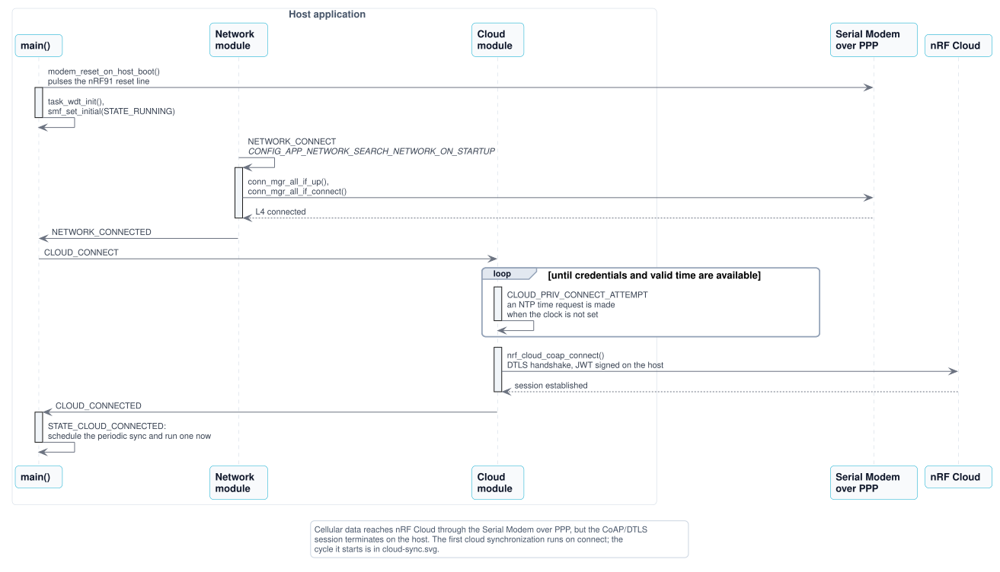
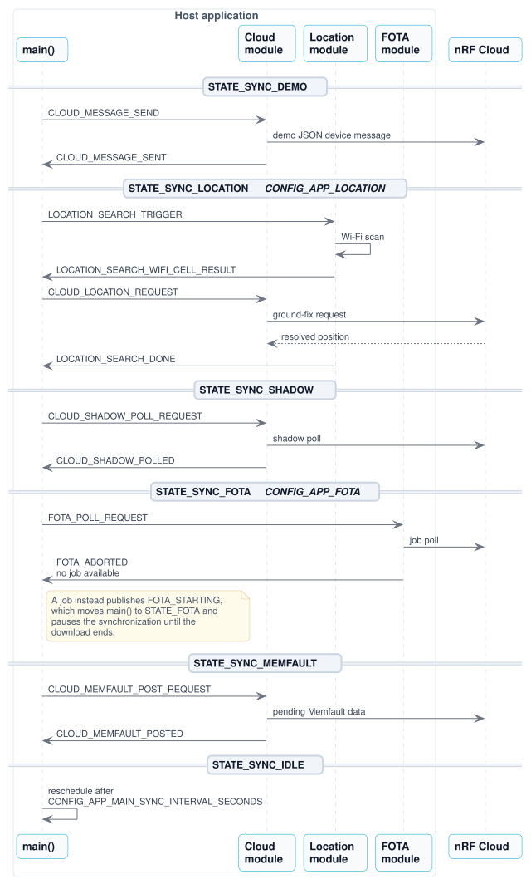

# Application behavior

This guide describes the general runtime behavior of the [PPP Host Application](https://github.com/nrfconnect/ncs-serial-modem-host-applications/blob/main/applications/ppp/). For the module design, zbus channels, and state machines, see [Architecture](../../architecture.md) and the [module overview](README.md#modules). For hardware wiring, build, and cloud provisioning, see the getting-started guide for [an nRF54 DK](../../getting-started/ppp-nrf54.md) or [the nRF93M1 DK](../../getting-started/ppp-nrf93m1.md).

## Overview

The application runs on the host MCU, an nRF54L15 or nRF54LM20B DK wired to an nRF9151 DK, or the nRF54L15 of the nRF93M1 DK, and treats the Serial Modem as a cellular data interface over PPP. Cloud connectivity uses host-native CoAP/DTLS to nRF Cloud. Credentials are stored in TF-M Protected Storage and used to sign JWTs for CoAP authentication.

Cooperating modules run as dedicated threads, each with its own SMF state machine, and communicate through zbus channels. See the [module overview](README.md#modules) for details about the modules and their interactions.

## Startup sequence

1. **Boot** — MCUboot loads the application. On boards with a modem reset GPIO, `modem_reset.c` pulses the nRF91 reset line before the modules start. The nRF Cloud library logs the device ID (from the host HW ID), protocol, and security tag.
1. **Network** - The network module connects on startup. When L4 connectivity is established it publishes `NETWORK_CONNECTED`.
1. **Cloud** - On network up, the cloud module waits for valid time (NTP over PPP) and installed credentials, then calls `nrf_cloud_coap_connect()`. Missing credentials or time cause a retry every 10 seconds (`CONFIG_APP_CLOUD_CREDENTIAL_RETRY_SECONDS`).
1. **Main** - When the cloud module publishes `CLOUD_CONNECTED`, main transitions to the cloud-connected state and runs the first cloud synchronization.

## Cloud synchronization

While nRF Cloud is connected, main keeps a periodic timer on a dedicated workqueue (`CONFIG_APP_MAIN_SYNC_INTERVAL_SECONDS`, default 600 seconds). Each synchronization runs through a sequence of substates, waiting for the current step to finish before starting the next:

1. Sends a demo JSON device message on `cloud_chan` (payload: `{"appId":"SMHA","messageType":"DATA","data":"hello"}`), then waits for `CLOUD_MESSAGE_SENT`.
1. Publishes `LOCATION_SEARCH_TRIGGER` on `location_chan` when the Location module is built (`CONFIG_APP_LOCATION`, on the nRF54 hosts only with the location overlay), then waits for `LOCATION_SEARCH_DONE`.
1. Publishes `CLOUD_SHADOW_POLL_REQUEST` on `cloud_chan` to pick up any desired configuration from the device shadow, then waits for `CLOUD_SHADOW_POLLED`.
1. Publishes `FOTA_POLL_REQUEST` on `fota_chan` to check for firmware updates, then waits for `FOTA_ABORTED` or enters the FOTA download state on `FOTA_STARTING`.
1. Publishes `CLOUD_MEMFAULT_POST_REQUEST` on `cloud_chan` to post any pending remote debugging data, then waits for `CLOUD_MEMFAULT_POSTED`.

An initial synchronization runs immediately on cloud connect. The timer is cancelled when the cloud disconnects. A new periodic trigger is only acted on while main is idle between synchronizations.

During the location step, the location module scans for Wi-Fi access points, on the nRF93M1 DK together with the serving cell, and publishes the result as `LOCATION_SEARCH_WIFI_CELL_RESULT`, which main forwards to the cloud module. The cloud module resolves it into a position with an nRF Cloud CoAP ground-fix request and logs the position together with a Google Maps URL. Main does not advance past the location step until `LOCATION_SEARCH_DONE` is published.

## Buttons and shell commands

While main is idle between synchronizations, the DK buttons act on the cloud connection:

- **Button 1** starts a cloud synchronization right away instead of waiting for the next interval.
- **Button 2** triggers a Memfault SDK heartbeat and posts the pending remote debugging data to nRF Cloud.

A press while a synchronization is running, or while the cloud is not connected, is logged and ignored. On the nRF54L15 DK and nRF54LM20 DK, button 1 is **BUTTON0** and button 2 is **BUTTON1**.

The console also offers these shell commands:

| Command | Action |
| --- | --- |
| `button 1` / `button 2` | Simulate a press of the matching button. |
| `network connect` / `network disconnect` | Bring the cellular link up or down. |
| `fota poll` / `fota cancel` | Check for a firmware update now, or cancel an ongoing download. |
| `location search` / `location cancel` | Start a Wi-Fi location search now, or cancel an ongoing one. Only available with the location overlay. |
| `at "<command>"` | Send an AT command to the modem and print the response. |

## Remote debugging

The Memfault SDK is configured for software type `smha-91m1` on the nRF54 hosts and `smha-93m1` on the nRF93M1 DK, and uploads through nRF Cloud CoAP (`CONFIG_MEMFAULT_USE_NRF_CLOUD_COAP`). The SDK collects heartbeat metrics on its internal timer. On the nRF93M1 DK it also uploads data periodically (`CONFIG_MEMFAULT_PERIODIC_UPLOAD`). On every board, the cloud module posts pending data on every cloud synchronization, when main asks for it with `CLOUD_MEMFAULT_POST_REQUEST`. Coredumps are RAM-backed. See [Remote debugging with nRF Cloud](remote-debugging.md) for nRF Cloud setup.

## Configuration

Check and configure the following Kconfig options for the application:

- **CONFIG_APP_CLOUD_CREDENTIAL_RETRY_SECONDS:**
  Retry interval when credentials or time are missing. The default value is `10`.
- **CONFIG_APP_MAIN_SYNC_INTERVAL_SECONDS:**
  Cloud sync interval while connected. The default value is `600`.
- **CONFIG_NRF_CLOUD_SEC_TAG:**
  TLS credential tag for nRF Cloud. The default value is `16842753`.

Per-module options are documented in the module guides linked from the [module overview](README.md#modules).
