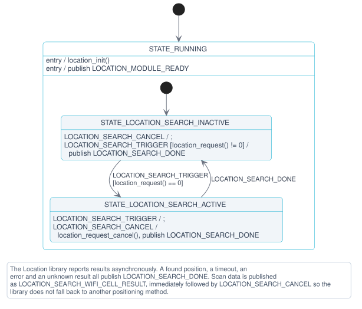

# Location module

The Location module collects location measurements on request and publishes them for the application to resolve into a position. It has two backends, selected with the `APP_LOCATION_BACKEND` choice. Both publish the same messages:

- **Location library** (`CONFIG_APP_LOCATION_BACKEND_LOCATION_LIB`, `location_lib.c`): Scans for nearby Wi-Fi® access points on the host through the [Location](https://docs.nordicsemi.com/bundle/ncs-latest/page/nrf/libraries/modem/location.html) library. It is used on the nRF54 host DKs. It is only built with the location overlay, which requires an nRF7002-EB2 shield for Wi-Fi scanning. See the [getting-started guide](../../../getting-started/ppp-nrf54.md) for wiring and build commands.
- **Modem AT commands** (`CONFIG_APP_LOCATION_BACKEND_MODEM_AT`, `location_at.c`): Reads the serving cell (`%BCINFO`) and scans for Wi-Fi access points (`%WIFISCAN`) through the nRF93M1 over the shared AT pipe. It is the default on the nRF93M1 DK, where the module is enabled in the default build.

## Modem AT backend

On `LOCATION_SEARCH_TRIGGER`, the backend publishes `LOCATION_SEARCH_STARTED`. It then reads the serving cell and scans for Wi-Fi access points, blocking the module thread while it waits for each AT response. A failed `%BCINFO` is retried once after `CONFIG_APP_LOCATION_BCINFO_RETRY_DELAY_SECONDS`, because the modem answers `ERROR` while another command is still running.

The measurements are published as `LOCATION_SEARCH_WIFI_CELL_RESULT`, unless there is no serving cell and fewer access points than nRF Cloud needs for a fix. The search always ends with `LOCATION_SEARCH_DONE`. A search has always finished by the time the next message is handled, so `LOCATION_SEARCH_CANCEL` is ignored.

## Location library backend

The Location library is configured to use an external cloud service for positioning, so the module never resolves a position itself. When a scan completes, the library asks for the scan data to be resolved externally, and the module publishes the access points as a `LOCATION_SEARCH_WIFI_CELL_RESULT` message. The [Main module](main.md) forwards that message to the [Cloud module](cloud.md), which performs the nRF Cloud ground fix request and logs the resulting position. This split keeps the module independent of which cloud the application uses.

Finding access points is treated as a successful search, regardless of whether the cloud can resolve them. The module therefore cancels the ongoing request as soon as the scan data has been published, which stops the Location library from falling back to another positioning method.

A search trigger that arrives while a search is already active is ignored, so a scan that takes longer than the application's synchronization period simply results in fewer position updates.

> [!NOTE]
> `CONFIG_LOCATION_DATA_DETAILS` cannot be enabled in this application, because it makes `<modem/location.h>` include nRF Modem GNSS headers that only exist when the nRF Modem Library is built, and the modem is external on the host. As a result, the Location library never emits `LOCATION_EVT_CANCELLED`, and the module completes a canceled search from its own context instead.

### State diagram

The Location library backend implements a hierarchical state machine with the following states and transitions:



### States

The following states are used by the backend:

- **STATE_RUNNING:** Parent state entered on initialization. Its entry function initializes the Location library and publishes `LOCATION_MODULE_READY`.

    - **STATE_LOCATION_SEARCH_INACTIVE:** Default substate, in which no search is running. A `LOCATION_SEARCH_TRIGGER` starts a search with `location_request()`, and the module only moves to the active state if that call succeeds. A failed request is reported as a completed search with `LOCATION_SEARCH_DONE`, so the application is not left waiting.
    - **STATE_LOCATION_SEARCH_ACTIVE:** A Wi-Fi scan is running. Further triggers are ignored. A `LOCATION_SEARCH_CANCEL` cancels the request and completes the search by publishing `LOCATION_SEARCH_DONE`.

Search results arrive asynchronously from the Location library. Location found, timeout, error, and unknown result all lead to `LOCATION_SEARCH_DONE`, which returns the module to the inactive state.

## Messages

The Location module communicates on the `location_chan` channel. The messages are defined in `location.h`.

### Input messages

The following describes the input messages supported by the module:

- **LOCATION_SEARCH_TRIGGER**: Request to start a location search, which collects measurements and publishes them as `LOCATION_SEARCH_WIFI_CELL_RESULT`.
- **LOCATION_SEARCH_CANCEL**: Request to cancel an ongoing location search. With the Location library backend, Wi-Fi scans cannot be truly canceled at the driver level, so a canceled scan may keep running and cause `-EBUSY` on the next request. Use this only when necessary. The modem AT backend ignores it.

### Output messages

The following describes the output messages supported by the module:

- **LOCATION_MODULE_READY**: The Location module is initialized and ready to use.
- **LOCATION_SEARCH_STARTED**: A location search has been initiated and is now active.
- **LOCATION_SEARCH_DONE**: A location search has completed, successfully or because of a timeout or error. The module is ready to accept a new search.
- **LOCATION_SEARCH_WIFI_CELL_RESULT**: Scan data from a location search is available to be resolved into a position, for example by a cloud location service. The data is in the `.wifi_cell_result` field of the message. The Location library backend reports Wi-Fi access points only and leaves `cell.valid` false. The modem AT backend also reports the serving cell.

### Message structure

The following describes the message structure of the module:

```c
/** Serving cell information. */
struct location_cell_info {
	bool valid;
	int mcc;
	int mnc;
	int rsrp;
	int rsrq;
	int earfcn;
	int pci;
	uint32_t eci;
	uint32_t tac;
};

/** Wi-Fi access point information. */
struct location_wifi_ap_info {
	int8_t rssi;
	uint8_t mac[MAC_ADDR_LEN];
	uint8_t mac_length;
	uint8_t channel;
};

/** Cell and Wi-Fi scan data from a location search. */
struct location_search_wifi_cell_result {
	struct location_cell_info cell;
	uint16_t wifi_cnt;
	struct location_wifi_ap_info wifi_aps[CONFIG_APP_LOCATION_WIFI_APS_MAX];
};

struct location_msg {
	enum location_msg_type type;

	/** Cell and Wi-Fi scan data from a location search.
	 *  wifi_cell_result is valid for LOCATION_SEARCH_WIFI_CELL_RESULT messages.
	 */
	struct location_search_wifi_cell_result wifi_cell_result;
};
```

## Configurations

Check and configure the following Kconfig options:

- **CONFIG_APP_LOCATION**: Enables the Location module. Enabled by default when the Location library is enabled, which the location overlay does, and on the nRF93M1 DK.

- **CONFIG_APP_LOCATION_BACKEND_LOCATION_LIB** / **CONFIG_APP_LOCATION_BACKEND_MODEM_AT**: Selects the backend. The modem AT backend is the default on the nRF93M1 DK, and the Location library backend everywhere else.

- **CONFIG_APP_LOCATION_THREAD_STACK_SIZE**: Sets the stack size for the location module thread.

- **CONFIG_APP_LOCATION_WATCHDOG_TIMEOUT_SECONDS**: Defines the timeout in seconds for the location module watchdog. This timeout covers both waiting for incoming messages and message processing time.

- **CONFIG_APP_LOCATION_MSG_PROCESSING_TIMEOUT_SECONDS**: Sets the maximum time allowed for processing a single message in the module's state machine. This value must be smaller than the watchdog timeout.

- **CONFIG_APP_LOCATION_WIFI_APS_MAX**: Sets the maximum number of Wi-Fi access points stored in a location request, and thereby the size of `struct location_msg`. With the Location library backend, it must be at least `CONFIG_LOCATION_METHOD_WIFI_SCANNING_RESULTS_MAX_CNT`.

- **CONFIG_APP_LOCATION_SHELL**: Adds the `location search` and `location cancel` shell commands, which publish `LOCATION_SEARCH_TRIGGER` and `LOCATION_SEARCH_CANCEL`. Enabled by default when the shell is enabled.

- **CONFIG_APP_LOCATION_AT_RESPONSE_SIZE**, **CONFIG_APP_LOCATION_BCINFO_TIMEOUT_SECONDS**, **CONFIG_APP_LOCATION_WIFISCAN_TIMEOUT_SECONDS**, **CONFIG_APP_LOCATION_BCINFO_RETRY_DELAY_SECONDS**: Modem AT backend only. Set the AT response buffer size, the `%BCINFO` and `%WIFISCAN` timeouts, and the delay before retrying a failed `%BCINFO`. The message processing time must cover two `%BCINFO` attempts, the retry delay, and a `%WIFISCAN`.

- **CONFIG_APP_LOCATION_LOG_LEVEL_***: Controls the logging level for the location module. This follows Zephyr's standard logging configuration pattern.
