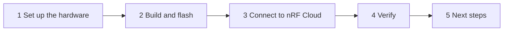

# Get started with the nRF91M1 PPP Host Application

This guide takes you from two development kits (DKs) to a device that sends data to nRF Cloud. An nRF54 Series DK runs the host application, and an [nRF9151 DK](https://www.nordicsemi.com/Products/Development-hardware/nRF9151-DK) or [nRF9151 SMA DK](https://www.nordicsemi.com/Products/Development-hardware/nRF9151-SMA-DK) runs the Serial Modem firmware. The host reaches the internet through the modem over PPP and connects to nRF Cloud over CoAP/DTLS itself.



Before you start, complete the [Before you begin](index.md#before-you-begin) checklist. To build from source, also complete [Set up the repository and toolchain](setup.md).

Pick your host setup now. Some steps differ between them:

| Host setup | Serial Modem link on the host | Host console |
|---|---|---|
| nRF54L15 DK | **P0** connector (`uart30`) | VCOM1 |
| nRF54LM20B DK | **P1**/**P2** connector (`uart21`) | VCOM0 |
| nRF54LM20B DK + nRF7002-EB II (Wi-Fi® location) | **P1**/**P2** connector (`uart21`) | VCOM0 |

The nRF7002-EB II is only needed for Wi-Fi location. The base application runs without it. The nRF9151 SMA DK only differs from the nRF9151 DK by its SMA antenna connector, so every step is identical for both.

To find the serial ports of a DK, run `nrfutil device list`. It lists each DK by serial number with its ports, marked as VCOM0 and VCOM1. On macOS the ports look like `/dev/cu.usbmodem*`, on Linux like `/dev/ttyACM*`, and on Windows like `COM*`.

## Step 1: Set up the hardware

The two DKs talk over UART with hardware flow control, DTR/RI, and a modem reset line.

You need the following:

- An nRF9151 DK or nRF9151 SMA DK with a SIM card.
- One host DK: nRF54L15 DK or nRF54LM20B DK.
- An nRF7002-EB II, only for the Wi-Fi location setup.
- Eight jumper wires: four for UART, one each for DTR, RI and modem reset, and one for ground.
- Two USB cables, one per DK.
- [nRF Connect for Desktop](https://www.nordicsemi.com/Products/Development-tools/nRF-Connect-for-Desktop) with the [Board Configurator app](https://docs.nordicsemi.com/bundle/nrf-connect-board-configurator/page/index.html), and [nRF Util](https://www.nordicsemi.com/Products/Development-tools/nRF-Util) with the `device` command for flashing.

### Configure the nRF9151 DK in Board Configurator

Each Board Configurator switch connects or disconnects a group of DK pins from the interface MCU, which is the on-board debugger behind the USB virtual serial ports (VCOM0 and VCOM1). Pins that carry the link between the two DKs must be disconnected, otherwise the interface MCU drives them too.

1. Connect the nRF9151 DK to your computer over USB and turn it on.
1. Open Board Configurator and select the nRF9151 DK.
1. Set **VCOM0** to **Disconnected**. This frees UART0 (**P0.26**/**P0.27** data, **P0.14**/**P0.15** flow control) for the host link.
1. Check that **VCOM0 HWFC** also reads **Disconnected**, and set it if not. If it stays connected, the interface MCU holds the modem's CTS deasserted through 150 Ω series resistors, and the modem never answers the host.
1. Leave **VCOM1** and **VCOM1 HWFC** connected. VCOM1 carries the Serial Modem logs (UART1, **P0.28**/**P0.29**), so a terminal on this port must be set to **1000000 baud**.
1. Note the **VDD** setting. You set the host DK to the same value later; 1.8 V is typical.
1. Write the configuration to the board.

### Flash the Serial Modem firmware

The host application needs the nRF91M1 variant of the Serial Modem firmware, which enables PPP and CMUX on UART0 using the nRF91M1 pinout. Any other variant listens on the USB serial port instead, and the host never gets an answer.

1. Download `serial_modem_<tag>_nrf9151dk_nrf91m1.zip` from the newest [ncs-serial-modem release](https://github.com/nrfconnect/ncs-serial-modem/releases) that ships it, or use the copy at the top level of your [release bundle](../release-artifacts.md#serial-modem-firmware-nrf9151-dk).
1. Extract the zip.
1. Flash the `.hex` on the nRF9151 DK. Replace `<modem_dk_serial_number>` with the serial number that `nrfutil device list` shows for the nRF9151 DK. `nrfutil device recover` erases the whole chip first:

    ```shell
    nrfutil device recover --serial-number <modem_dk_serial_number>
    nrfutil device program --firmware serial_modem_<tag>_nrf9151dk_nrf91m1.hex --serial-number <modem_dk_serial_number>
    nrfutil device reset --serial-number <modem_dk_serial_number>
    ```

To match an unreleased Serial Modem commit instead, build the modem application yourself. See the [Serial Modem getting started guide](https://docs.nordicsemi.com/bundle/addon-serial_modem-latest/page/gsg_guide.html#building_and_running).

### Configure the host DK in Board Configurator

1. Connect the host DK to your computer over USB and turn it on.
1. Open Board Configurator and select the host DK.
1. Set **VDD** to the same value as the nRF9151 DK.
1. Change the VCOM switches for your host setup:

    - **nRF54L15 DK:** Set **VCOM0** and **VCOM0 HWFC** to **Disconnected**. VCOM0 is the P0 connector (**P0.00**–**P0.03**, `uart30`), which carries the modem link. The host console uses VCOM1 (`uart20`).
    - **nRF54LM20B DK:** Leave all VCOM switches connected. The modem link uses `uart21` on pins the interface MCU does not touch, and the host console uses VCOM0 (`uart30`).
    - **nRF54LM20B DK + nRF7002-EB II:** Set **VCOM1** and **VCOM1 HWFC** to **Disconnected**, and leave VCOM0 connected for the host console (`uart30` on **P0.06**/**P0.07**).

1. Write the configuration to the board.

### Mount the nRF7002-EB II (Wi-Fi location only)

Skip this step unless you are building with Wi-Fi location.

1. Power off the nRF54LM20B DK.
1. Mount the EB II on the **P18 expansion header**. The expansion interface uses **P17** for GPIO/SPI signals and **P18** for 5 V power when the shield is plugged in.

### Wire the DKs together

Power off both DKs, then connect the eight wires from the table for your host DK. The nRF7002-EB II setup uses the same wiring as the plain nRF54LM20B DK.

**nRF54L15 DK:**

| nRF54L15 DK | nRF9151 DK | Signal |
|---|---|---|
| **P0.00** | **P0.26** | UART TX → RX |
| **P0.01** | **P0.27** | UART RX ← TX |
| **P0.02** | **P0.15** | UART RTS → CTS |
| **P0.03** | **P0.14** | UART CTS ← RTS |
| **P1.11** | **P0.31** | DTR |
| **P1.12** | **P0.30** | RI |
| **P1.10** | **P5 pin 5** | **nRESET** |
| GND | GND | Ground |

On the host, the UART pins are on the **P0** connector, and DTR, RI and modem reset are on the **P1** connector.

**nRF54LM20B DK:**

| nRF54LM20B DK | nRF9151 / SMA DK | Signal |
|---|---|---|
| **P1.8** | **P0.26** | UART TX → RX |
| **P1.9** | **P0.27** | UART RX ← TX |
| **P1.23** | **P0.15** | UART RTS → CTS |
| **P1.24** | **P0.14** | UART CTS ← RTS |
| **P1.11** | **P0.31** (**P3**) | DTR |
| **P1.12** | **P0.30** (**P3**) | RI |
| **P1.10** | **P5 pin 5** | **nRESET** |
| GND | GND | Ground |

All host pins are on the **P1**/**P2** connector. DTR and RI on **P1.11**/**P1.12** take the DK's default `uart21` flow-control pins, so the host overlay moves RTS/CTS to **P1.23**/**P1.24**.

On the nRF9151 DK, the UART0 pins are on the DK edge, DTR and RI are on **P3**, and nRESET is on **P5 pin 5**.

When wiring, check the following:

- **The UART pairs cross.** Host TX goes to modem RX, and host RTS goes to modem CTS on **P0.15**, not **P0.14**, which is the modem's RTS. Wiring either pair straight through leaves the modem silent while it still boots and takes reset pulses normally.
- **Connect all four UART wires plus DTR and RI.** The link is unreliable without flow control or DTR.
- **Do not jumper P0.31 to GND** on the nRF9151 DK. That jumper is only for a PC host; this application drives DTR from host pin **P1.11**.

**Checkpoint:** Both DKs are configured in Board Configurator, the nRF9151 DK runs the `nrf91m1` Serial Modem firmware, and the eight wires are connected. For the full Board Configurator table and pinout, see the [Hardware reference](../applications/91m1_ppp/hardware-setup.md).

## Step 2: Build and flash

Power on both DKs. Run the following commands inside the toolchain shell (see [Start the toolchain shell](setup.md#start-the-toolchain-shell)), from `smha-workspace/project`. Pick the build for your host setup:

**nRF54L15 DK:**

```shell
cd applications/91m1_ppp
west build -b nrf54l15dk/nrf54l15/cpuapp/ns -p
```

**nRF54LM20B DK:**

```shell
cd applications/91m1_ppp
west build -b nrf54lm20dk/nrf54lm20b/cpuapp/ns -p
```

**nRF54LM20B DK + nRF7002-EB II:**

```shell
cd applications/91m1_ppp
west build -b nrf54lm20dk/nrf54lm20b/cpuapp/ns -p -- \
  -DSHIELD=nrf7002eb2 \
  -DEXTRA_CONF_FILE=overlay-location.conf \
  -DSB_EXTRA_CONF_FILE=sysbuild-location.conf
```

Then flash the host DK:

```shell
west flash --recover
```

Two DKs are connected, so `west` asks which one to flash. Pick the serial number of the **host** DK, not the nRF9151 DK.

> [!IMPORTANT]
> `--recover` erases the whole chip, including the device credentials you install in the next step. Use it only for the first flash. After you have installed credentials, re-flash with a plain `west flash` to keep them.

**Using pre-built firmware instead:** Download the `91m1_ppp-nrf54l15-*`, `91m1_ppp-nrf54lm20b-*`, or `91m1_ppp-nrf54lm20b-location-*` zip from the [latest release](https://github.com/nrfconnect/ncs-serial-modem-host-applications/releases), extract it, and flash `merged.hex` on the host DK. The same credential warning applies to `nrfutil device recover`:

```shell
nrfutil device recover --serial-number <host_dk_serial_number>
nrfutil device program --firmware merged.hex --serial-number <host_dk_serial_number>
nrfutil device reset --serial-number <host_dk_serial_number>
```

See [Release artifacts](../release-artifacts.md) for what the zip contains.

**Checkpoint:** The host boots and brings up the link to the modem.

1. Open a serial terminal at 115200 baud on the host console: VCOM1 on the nRF54L15 DK, VCOM0 on the nRF54LM20B DK. Do not use VCOM1 of the nRF54LM20B DK while the EB II is attached.
1. Optionally, open a second terminal on VCOM1 of the nRF9151 DK at **1000000 baud** to see the Serial Modem boot logs. At 115200 baud it shows nothing.
1. Reset the host DK. On boot, the host pulses the modem's nRESET for 500 ms and gives it 2 s to start before it opens the link.
1. Note the **Device ID** in the boot log. You need it in the next step:

    ```text
    <inf> nrf_cloud_info: Device ID: E4361AD8FD3E4554
    ```

    This 16-character hex ID comes from the host SoC hardware ID. It is not the nRF91 modem UUID.

1. Wait for the PPP link through the modem to come up:

    ```text
    <inf> main: Network connected
    ```

If the host logs `init_chat_script: timed out` instead, the modem is not answering. Check, in order:

- The nRF9151 DK runs the `nrf91m1` Serial Modem variant.
- VCOM0 **and** VCOM0 HWFC are disconnected on the nRF9151 DK.
- The TX/RX and RTS/CTS pairs cross as shown in the wiring tables.

## Step 3: Connect to nRF Cloud

The host connects to nRF Cloud with its own certificate and private key. You create a certificate authority (CA) once, use it to install credentials on the device, and register the device in your nRF Cloud account.

Run the following commands from a normal terminal, not the toolchain shell. Keep the host console port free, because the credential installer uses it. Close the serial terminal on that port first.

1. Install the nRF Cloud command-line tools (once per computer):

    ```shell
    pip3 install nrfcloud-utils
    ```

1. Create a self-signed CA certificate (once, reuse it for all your devices). Replace `US` with your two-letter country code:

    ```shell
    create_ca_cert -c US -f self_
    ```

    This creates `self_<serial>_ca.pem`, `self_<serial>_prv.pem`, and `self_<serial>_pub.pem`. Keep the CA private key safe.

1. Install the device credentials on the host. Replace `<device_id>` with the Device ID from step 2, and `<console_port>` with the host console port:

    ```shell
    device_credentials_installer \
      --ca self_<serial>_ca.pem \
      --ca-key self_<serial>_prv.pem \
      --id-str <device_id> \
      -s -d --verify --coap --local-cert --cmd-type tls_cred_shell \
      --port <console_port>
    ```

    On success, it saves an onboarding file:

    ```text
    Saving nRF Cloud device onboarding CSV file onboard.csv...
    Onboarding CSV file saved, row count: 1
    ```

    The command also saves the device certificate and private key as PEM files in the current directory. Delete the device private key file afterwards. For what each option does, see [Credentials explained](../applications/91m1_ppp/README.md#credentials-explained).

1. Register the device in your nRF Cloud account. Get an API key from your [nRF Cloud user account](https://nrfcloud.nordicsemi.com/):

    ```shell
    nrf_cloud_onboard --api-key <your_api_key> --csv onboard.csv
    ```

**Checkpoint:** Open the serial terminal on the host console again. The cloud module retries every 10 seconds, so within a few seconds the log shows the following:

```text
<inf> main: Cloud connected
```

If the connection does not come up, check these first:

| Log | Fix |
|-----|-----|
| `Missing nRF Cloud credentials` | The credentials are not installed. Re-run `device_credentials_installer` with `--coap --cmd-type tls_cred_shell`. |
| `nrf_cloud_coap_connect` authentication failure | The device is not registered, or was registered with another ID. Check that you used the host **Device ID** from the boot log, not the modem UUID, and re-run `nrf_cloud_onboard`. |
| `device_credentials_installer` cannot connect | Check that the shell prompt `uart:~$` shows on the port you passed with `--port`, and that no terminal has the port open. |

The credentials are kept across reboots and plain re-flashes.

## Step 4: Verify

When the cloud connects, the application runs its first **cloud synchronization**. It sends a device message (`{"appId":"SMHA","messageType":"DATA","data":"hello"}`), polls the device shadow, checks for firmware updates, and uploads pending Memfault data. With the Wi-Fi location build, it also scans for Wi-Fi access points and logs the resolved position. The synchronization repeats every 10 minutes while the cloud stays connected (`CONFIG_APP_MAIN_SYNC_INTERVAL_SECONDS`).

1. Wait for the first synchronization to complete in the host console. With no errors after `Cloud connected`, the device is sending data.
1. Log in to [nRF Cloud](https://nrfcloud.com/) and find the device under its Device ID in the device list.

If something goes wrong later, see [Troubleshooting](../applications/91m1_ppp/README.md#troubleshooting) for the complete list of symptoms and fixes.

## Step 5: Next steps

| I want to | Read |
|-----------|------|
| Update the host firmware over the air | [Application FOTA](../app-fota.md) |
| See crashes and device metrics remotely | [Memfault remote debugging](../applications/91m1_ppp/memfault.md) |
| Understand what the application does at runtime | [Application behavior](../applications/91m1_ppp/application-behavior.md) |
| Change the sync interval or other settings | [Configuration](../applications/91m1_ppp/application-behavior.md#configuration) |
| Send AT commands to the Serial Modem and read its logs | [Reaching Serial Modem AT commands](../applications/91m1_ppp/README.md#reaching-serial-modem-at-commands) |
| Understand the module design | [Architecture](../architecture.md) and the [nRF91M1 PPP modules](../applications/91m1_ppp/README.md#modules) |
| Contribute changes | [CI and contribution](../ci-and-contribution.md) |

---

**Previous:** [Set up the repository and toolchain](setup.md) | **Up:** [Getting started](index.md)
