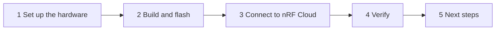

# Get started with the nRF93M1 PPP Host Application

This guide takes you from an [nRF93M1 DK](https://www.nordicsemi.com/Products/Development-hardware/nRF93M1-DK) to a device that sends data to nRF Cloud. The application runs on the DK's nRF54L15 host. It reaches the internet through the on-board nRF93M1 modem over PPP, and connects to nRF Cloud over CoAP/DTLS itself.



Before you start, complete the [Before you begin](index.md#before-you-begin) checklist. To build from source, also complete [Set up the repository and toolchain](setup.md).

## Step 1: Set up the hardware

The host and the modem are on the same DK, so there is no wiring.

1. Connect the nRF93M1 DK to your computer over USB and turn it on.
1. Run `nrfutil device list` and note the DK's serial number and its **VCOM0** port. VCOM0 is the host console (`uart20`). On macOS the port looks like `/dev/cu.usbmodem*`, on Linux like `/dev/ttyACM*`, and on Windows like `COM*`.

This guide only flashes the nRF54L15 host. The nRF93M1 must run Serial Modem firmware with PPP and CMUX enabled, and keeps it.

**Checkpoint:** `nrfutil device list` shows the nRF93M1 DK.

## Step 2: Build and flash

Run the following commands inside the toolchain shell (see [Start the toolchain shell](setup.md#start-the-toolchain-shell)), from `smha-workspace/project`:

```shell
cd applications/93m1_ppp
west build -b nrf93m1dk/nrf54l15/cpuapp/ns -p
west flash --recover
```

> [!IMPORTANT]
> `--recover` erases the whole chip, including the device credentials you install in the next step. Use it only for the first flash. After you have installed credentials, re-flash with a plain `west flash` to keep them.

**Using pre-built firmware instead:** Download the `93m1_ppp-nrf93m1-*` zip from the [latest release](https://github.com/nrfconnect/ncs-serial-modem-host-applications/releases), extract it, and flash `merged.hex`. The same credential warning applies to `nrfutil device recover`:

```shell
nrfutil device recover --serial-number <dk_serial_number>
nrfutil device program --firmware merged.hex --serial-number <dk_serial_number>
nrfutil device reset --serial-number <dk_serial_number>
```

See [Release artifacts](../release-artifacts.md) for what the zip contains.

**Checkpoint:** The host boots and brings up the cellular link.

1. Open a serial terminal at 115200 baud on VCOM0 and reset the DK.
1. Note the **Device ID** in the boot log. You need it in the next step:

    ```text
    <inf> nrf_cloud_info: Device ID: <16-hex-device-id>
    ```

    This 16-character hex ID comes from the nRF54L15 hardware ID. It is not the modem UUID.

1. Wait for the PPP link through the modem to come up:

    ```text
    <inf> main: Network connected
    ```

## Step 3: Connect to nRF Cloud

The host connects to nRF Cloud with its own certificate and private key. You create a certificate authority (CA) once, use it to install credentials on the device, and register the device in your nRF Cloud account.

Run the following commands from a normal terminal, not the toolchain shell. The credential installer uses the console port, so close the serial terminal on VCOM0 first.

1. Install the nRF Cloud command-line tools (once per computer):

    ```shell
    pip3 install nrfcloud-utils
    ```

1. Create a self-signed CA certificate (once, reuse it for all your devices). Replace `US` with your two-letter country code:

    ```shell
    create_ca_cert -c US -f self_
    ```

    This creates `self_<serial>_ca.pem`, `self_<serial>_prv.pem`, and `self_<serial>_pub.pem`. Keep the CA private key safe.

1. Install the device credentials on the host. Replace `<device_id>` with the Device ID from step 2, and `<console_port>` with the VCOM0 port:

    ```shell
    device_credentials_installer \
      --ca self_<serial>_ca.pem \
      --ca-key self_<serial>_prv.pem \
      --id-str <device_id> \
      -s -d --verify --coap --local-cert --cmd-type tls_cred_shell \
      --port <console_port>
    ```

    On success, it saves an onboarding file named `onboard.csv`. The command also saves the device certificate and private key as PEM files in the current directory. Delete the device private key file afterwards. For what each option does, see [Credentials explained](../applications/91m1_ppp/README.md#credentials-explained), which applies to this application too.

1. Register the device in your nRF Cloud account. Get an API key from your [nRF Cloud user account](https://nrfcloud.nordicsemi.com/):

    ```shell
    nrf_cloud_onboard --api-key <your_api_key> --csv onboard.csv
    ```

**Checkpoint:** Open the serial terminal on VCOM0 again and reset the DK. After `Network connected`, the cloud module connects and uploads its first diagnostics:

```text
<dbg> cloud: Cloud connected
<dbg> cloud: Diagnostics uploaded
```

If the CA certificate or private key is missing, each attempt logs what is missing instead and skips the connection until you install the credentials:

```text
<wrn> cloud: Missing nRF Cloud credentials (see docs/applications/93m1_ppp/README.md)
<wrn> cloud:   - CA cert (run device_credentials_installer --coap)
```

If the connection is refused, check that you onboarded the host **Device ID** from the boot log, not the modem UUID, and re-run `nrf_cloud_onboard`.

## Step 4: Verify

The application runs a **cloud synchronization** shortly after the network connects, and then every 10 minutes (`CONFIG_APP_MAIN_SYNC_INTERVAL_SECONDS`). Each synchronization uploads heartbeats and diagnostics, requests a location fix, and checks for firmware updates. The last step of a synchronization without a pending update logs:

```text
<inf> main: No FOTA update available
```

1. Wait for that line in the console, or press **Button 1** on the DK to start a synchronization right away.
1. Log in to [nRF Cloud](https://nrfcloud.com/) and find the device under its Device ID. Heartbeats and metrics appear in the linked nRF Cloud project.

If something goes wrong later, see [Troubleshooting](../applications/93m1_ppp/README.md#troubleshooting).

## Step 5: Next steps

| I want to | Read |
|-----------|------|
| Update the host firmware over the air | [Application FOTA](../app-fota.md) |
| See crashes and device metrics remotely | [Memfault remote debugging](../applications/91m1_ppp/memfault.md), which works the same way on this application |
| Learn the buttons and shell commands | [nRF93M1 PPP Host Application](../applications/93m1_ppp/README.md) |
| Understand the module design | [Architecture](../architecture.md) |
| Contribute changes | [CI and contribution](../ci-and-contribution.md) |

---

**Previous:** [Set up the repository and toolchain](setup.md) | **Up:** [Getting started](index.md)
