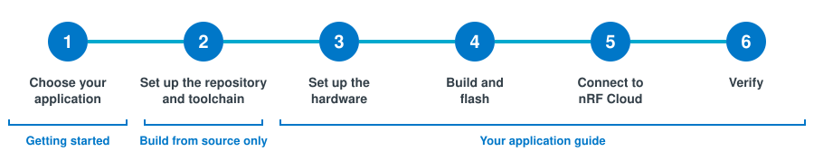

# Getting started

This guide takes you from an unboxed development kit (DK) to a device that sends data to nRF Cloud in six steps. You choose your application on this page, set up the command-line tools if you build from source, and then follow the guide for your application from step 3 to the end.

## Step 1: Choose your application

1. Make sure you have the following before you start, so you do not get stuck halfway:

    - A SIM card with a data plan.
    - An [nRF Cloud](https://nrfcloud.nordicsemi.com/) account.
    - A serial terminal, such as the [Serial Terminal app](https://www.nordicsemi.com/Products/Development-tools/nRF-Connect-for-Desktop) in nRF Connect for Desktop, PuTTY, Tera Term, or minicom.
    - [nRF Util](https://docs.nordicsemi.com/bundle/nrfutil/page/guides/installing.html) with the `device` command, which flashes the DKs. After installing nRF Util, run `nrfutil install device`.
    - For the PPP Host Application, Python 3 with `pip`, which installs the nRF Cloud command-line tools in step 5.

1. Find your hardware in the following table and note the guide for your application. You follow that guide from step 3.

    | Your hardware | Application | Guide |
    |---------------|-------------|-------|
    | [nRF54L15 DK](https://www.nordicsemi.com/Products/Development-hardware/nRF54L15-DK) or [nRF54LM20B DK](https://www.nordicsemi.com/Products/Development-hardware/nRF54LM20-DK), wired to an [nRF9151 DK](https://www.nordicsemi.com/Products/Development-hardware/nRF9151-DK) | PPP Host Application | [Get started with PPP on an nRF54 DK](ppp-nrf54.md) |
    | [nRF93M1 DK](https://www.nordicsemi.com/Products/Development-hardware/nRF93M1-DK) | PPP Host Application | [Get started with PPP on the nRF93M1 DK](ppp-nrf93m1.md) |
    | [nRF93M1 DK](https://www.nordicsemi.com/Products/Development-hardware/nRF93M1-DK) | nRF93M1 AT Host Application | [Get started with nRF93M1 AT](93m1-at.md) |

1. Choose how you get the firmware:

    - **Build from source:** You build the firmware yourself and can change it. Continue to [Step 2: Set up the repository and toolchain](setup.md).
    - **Flash pre-built firmware:** You flash firmware from the [latest release](https://github.com/nrfconnect/ncs-serial-modem-host-applications/releases) to evaluate the application. Skip step 2 and go straight to step 3 in your application guide. In step 4, follow the pre-built firmware option. See [Release artifacts](../release-artifacts.md) for what each release zip contains.

---

**Next:** [Step 2: Set up the repository and toolchain](setup.md), or step 3 in your application guide if you flash pre-built firmware
