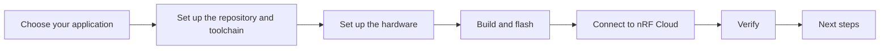

# Getting started

This guide takes you from an unboxed development kit (DK) to a device that sends data to nRF Cloud. You pick your application once, set up the command-line tools, and then follow one guide for your application from start to finish.

## Before you begin

Make sure you have the following before you start, so you do not get stuck halfway:

- The hardware for your application, see [Choose your application](#choose-your-application).
- A SIM card with a data plan for the nRF9151 DK, if you use the nRF91M1 PPP Host Application.
- An [nRF Cloud](https://nrfcloud.com/) account. The PPP applications also need an nRF Cloud API key to onboard the device.
- A computer running Windows, Linux, or macOS, with Python 3 and `pip3` for the nRF Cloud command-line tools.
- A serial terminal, such as the [Serial Terminal app](https://www.nordicsemi.com/Products/Development-tools/nRF-Connect-for-Desktop) in nRF Connect for Desktop, PuTTY, Tera Term, or minicom.
- Disk space and some time for the first `west update`, which downloads the nRF Connect SDK and all its modules.

## Choose your application

Start from the hardware you have:

| Your hardware | Application | Guide |
|---------------|-------------|-------|
| [nRF54L15 DK](https://www.nordicsemi.com/Products/Development-hardware/nRF54L15-DK) or [nRF54LM20B DK](https://www.nordicsemi.com/Products/Development-hardware/nRF54LM20-DK), wired to an [nRF9151 DK](https://www.nordicsemi.com/Products/Development-hardware/nRF9151-DK) | nRF91M1 PPP Host Application | [Get started with nRF91M1 PPP](91m1-ppp.md) |
| [nRF93M1 DK](https://www.nordicsemi.com/Products/Development-hardware/nRF93M1-DK) | nRF93M1 PPP Host Application | [Get started with nRF93M1 PPP](93m1-ppp.md) |
| [nRF93M1 DK](https://www.nordicsemi.com/Products/Development-hardware/nRF93M1-DK) | nRF93M1 AT Host Application | [Get started with nRF93M1 AT](93m1-at.md) |

### nRF93M1 DK: PPP or AT?

Both applications run on the same DK. They differ in where the cloud connection lives:

| | nRF93M1 PPP | nRF93M1 AT |
|---|---|---|
| Who talks to nRF Cloud | The host MCU, over its own IP stack. The modem only carries IP traffic over PPP. | The modem, with its built-in nRF Cloud client. The host sends it AT commands. |
| Device identity | Host certificate and key that you install | Modem UUID that you claim in nRF Cloud |
| Host firmware updates over the air (FOTA) | Yes | No |
| Memfault crash reporting | Yes | No |
| Choose it if | You want to build a product on the host's IP stack | You want a minimal host and let the modem handle the cloud |

## Choose your path

- **Develop:** You build the firmware from source and can change it. Continue to [Set up the repository and toolchain](setup.md).
- **Evaluate:** You flash pre-built firmware from the [latest release](https://github.com/nrfconnect/ncs-serial-modem-host-applications/releases) and skip the toolchain setup. Go straight to your application guide and follow the pre-built option in the build and flash step. See [Release artifacts](../release-artifacts.md) for what each release zip contains.

---

**Next:** [Set up the repository and toolchain](setup.md)
