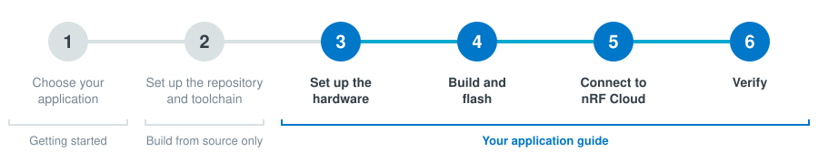

# Get started with the PPP Host Application on an nRF54 DK

This guide takes you from two development kits (DKs) to a device that sends data to nRF Cloud. An nRF54 Series DK runs the [PPP Host Application](../applications/ppp/README.md), and an [nRF9151 DK](https://www.nordicsemi.com/Products/Development-hardware/nRF9151-DK) or [nRF9151 SMA DK](https://www.nordicsemi.com/Products/Development-hardware/nRF9151-SMA-DK) runs the Serial Modem firmware. The host reaches the internet through the modem over PPP and connects to nRF Cloud over CoAP/DTLS itself.



Before you start, complete [Step 1: Choose your application](index.md#step-1-choose-your-application). To build from source, also complete [Step 2: Set up the repository and toolchain](setup.md).

## Step 3: Set up the hardware

The two DKs talk over UART with hardware flow control, DTR/RI, and a modem reset line.

You need the following:

- An nRF9151 DK or nRF9151 SMA DK with a SIM card.
- One host DK: nRF54L15 DK or nRF54LM20B DK.
- An nRF7002-EB II, optional to get Wi-Fi location.
- Eight jumper wires: four for UART, one each for DTR, RI and modem reset, and one for ground.
- Two USB cables, one per DK.
- [nRF Connect for Desktop](https://www.nordicsemi.com/Products/Development-tools/nRF-Connect-for-Desktop) with the [Board Configurator app](https://docs.nordicsemi.com/bundle/nrf-connect-board-configurator/page/index.html).

Each Board Configurator switch connects or disconnects a group of DK pins from the interface MCU, which is the on-board debugger behind the USB virtual serial ports (VCOM0 and VCOM1). Pins that carry the link between the two DKs must be disconnected, otherwise the interface MCU drives them too.

### 3.1 Configure the nRF9151 DK in Board Configurator

1. Connect the nRF9151 DK to your computer over USB and turn it on.
1. Open Board Configurator and select the nRF9151 DK.
1. Set **VCOM0** to **Disconnected**.
1. Set **VDD** to **1.8 V**. The host DK must use the same voltage.
1. Write the configuration to the board and reset the board.

### 3.2 Flash the Serial Modem firmware

1. Download `serial_modem_<tag>_nrf9151dk_nrf91m1.zip` from the newest [ncs-serial-modem release](https://github.com/nrfconnect/ncs-serial-modem/releases) that ships it, or use the copy at the top level of your [release bundle](../release-artifacts.md#serial-modem-firmware-nrf9151-dk).
1. Extract the zip.
1. Flash the `.hex` on the nRF9151 DK. Replace `<modem_dk_serial_number>` with the serial number that `nrfutil device list` shows for the nRF9151 DK. `nrfutil device recover` erases the whole chip first:

    ```shell
    nrfutil device recover --serial-number <modem_dk_serial_number>
    nrfutil device program --firmware serial_modem_<tag>_nrf9151dk_nrf91m1.hex --serial-number <modem_dk_serial_number>
    nrfutil device reset --serial-number <modem_dk_serial_number>
    ```

### 3.3 Configure the nRF54 DK in Board Configurator

1. Connect the host DK to your computer over USB and turn it on.
1. Open Board Configurator and select the host DK.
1. Set **VDD** to **1.8 V**, the same as the nRF9151 DK.
1. Change the VCOM switches for your host DK:

    - **nRF54L15 DK:** Set **VCOM0** to **Disconnected**.
    - **nRF54LM20B DK:** Keep the board defaults. No VCOM change is needed.

1. Write the configuration to the board and reset the board.

### 3.4 Wire the DKs together

1. Power off both DKs.
1. Connect the eight wires from the table for your host DK.

    **nRF54L15 DK:**

    | nRF54L15 DK | nRF9151 DK | Signal |
    |---|---|---|
    | **P0.00** | **P0.26** | UART TX → RX |
    | **P0.01** | **P0.27** | UART RX ← TX |
    | **P0.02** | **P0.15** | UART RTS → CTS |
    | **P0.03** | **P0.14** | UART CTS ← RTS |
    | **P1.11** | **P0.31** | DTR |
    | **P1.12** | **P0.30** | RI |
    | **P1.10** | **P5 pin 5** | **nRESET** |
    | GND | GND | Ground |

    **nRF54LM20B DK:**

    | nRF54LM20B DK | nRF9151 / SMA DK | Signal |
    |---|---|---|
    | **P1.14** | **P0.26** | UART TX → RX |
    | **P1.15** | **P0.27** | UART RX ← TX |
    | **P1.23** | **P0.15** | UART RTS → CTS |
    | **P1.24** | **P0.14** | UART CTS ← RTS |
    | **P1.11** | **P0.31** (**P3**) | DTR |
    | **P1.12** | **P0.30** (**P3**) | RI |
    | **P1.10** | **P5 pin 5** | **nRESET** |
    | GND | GND | Ground |

1. For Wi-Fi location, mount the nRF7002-EB II on the **P17** expansion header of the nRF54LM20B DK.
1. Power on both DKs.

## Step 4: Build and flash

> [!IMPORTANT]
> `west flash --recover` and `nrfutil device recover` erase the whole chip, including the device credentials you install in step 5. Use them only for the first flash. After you have installed credentials, re-flash with a plain `west flash`, or with `nrfutil device program` without the `recover` command, to keep them.

1. Flash the host firmware on the host DK. Choose one of the following options:

    - **Build from source:** Run the following commands inside the toolchain shell (step 2.4 in [Set up the repository and toolchain](setup.md)), from `smha-workspace/project`. Pick the build for your host setup:

        **nRF54L15 DK:**

        ```shell
        cd applications/ppp
        west build -b nrf54l15dk/nrf54l15/cpuapp/ns -p
        ```

        **nRF54LM20B DK:**

        ```shell
        cd applications/ppp
        west build -b nrf54lm20dk/nrf54lm20b/cpuapp/ns -p
        ```

        **nRF54LM20B DK + nRF7002-EB II:**

        ```shell
        cd applications/ppp
        west build -b nrf54lm20dk/nrf54lm20b/cpuapp/ns -p -- \
          -DSHIELD=nrf7002eb2 \
          -DEXTRA_CONF_FILE=overlay-location.conf \
          -DSB_EXTRA_CONF_FILE=sysbuild-location.conf
        ```

        Then flash the host DK:

        ```shell
        west flash --recover
        ```

    - **Pre-built firmware:** Download the zip for your host setup from the [latest release](https://github.com/nrfconnect/ncs-serial-modem-host-applications/releases): `ppp-nrf54l15-*` for the nRF54L15 DK, `ppp-nrf54lm20b-*` for the nRF54LM20B DK, or `ppp-nrf54lm20b-location-*` for the nRF54LM20B DK with the nRF7002-EB II. Extract it, and flash `merged.hex` on the host DK. See [Release artifacts](../release-artifacts.md) for what the zip contains.

        ```shell
        nrfutil device recover --serial-number <host_dk_serial_number>
        nrfutil device program --firmware merged.hex --serial-number <host_dk_serial_number>
        nrfutil device reset --serial-number <host_dk_serial_number>
        ```

1. Open a serial terminal at 115200 baud on the host console: VCOM1 on the nRF54L15 DK, VCOM0 on the nRF54LM20B DK.
1. Reset the host DK.
1. Note the **Device ID** in the boot log. You need it in step 5:

    ```text
    <inf> nrf_cloud_info: Device ID: E4361AD8FD3E4554
    ```

    This 16-character hex ID comes from the host SoC hardware ID. It is not the nRF91 modem UUID.

1. Wait for the PPP link through the modem to come up.

**Checkpoint:** The console logs the following:

```text
<inf> main: Network connected
```

## Step 5: Connect to nRF Cloud

The host connects to nRF Cloud with its own certificate and private key. You create a certificate authority (CA) once, use it to install credentials on the device, and register the device in your nRF Cloud account.

Run the following commands from a normal terminal, not the toolchain shell. Keep the host console port free, because the credential installer uses it. Close the serial terminal on that port first.

1. Install the nRF Cloud command-line tools (once per computer):

    ```shell
    pip3 install nrfcloud-utils
    ```

1. Create a self-signed CA certificate (once, reuse it for all your devices). Replace `US` with your two-letter country code:

    ```shell
    create_ca_cert -c US -f self_
    ```

    This creates `self_<serial>_ca.pem`, `self_<serial>_prv.pem`, and `self_<serial>_pub.pem`. Keep the CA private key safe.

1. Install the device credentials on the host. Replace `<device_id>` with the Device ID from step 4.4, and `<console_port>` with the host console port:

    ```shell
    device_credentials_installer \
      --ca self_<serial>_ca.pem \
      --ca-key self_<serial>_prv.pem \
      --id-str <device_id> \
      -s -d --verify --coap --local-cert --cmd-type tls_cred_shell \
      --port <console_port>
    ```

    On success, it saves an onboarding file:

    ```text
    Saving nRF Cloud device onboarding CSV file onboard.csv...
    Onboarding CSV file saved, row count: 1
    ```

    The command also saves the device certificate and private key as PEM files in the current directory. Delete the device private key file afterwards.

1. Register the device in your nRF Cloud account. Get an API key from your [nRF Cloud user account](https://nrfcloud.nordicsemi.com/):

    ```shell
    nrf_cloud_onboard --api-key <your_api_key> --csv onboard.csv
    ```

1. Open the serial terminal on the host console again.

**Checkpoint:** The cloud module retries every 10 seconds, so within a few seconds the log shows the following:

```text
<inf> main: Cloud connected
```

## Step 6: Verify

When the cloud connects, the application runs its first **cloud synchronization**. It sends a device message (`{"appId":"SMHA","messageType":"DATA","data":"hello"}`), polls the device shadow, checks for firmware updates, and uploads pending remote debugging data. With the Wi-Fi location build, it also scans for Wi-Fi access points and logs the resolved position. The synchronization repeats every 10 minutes while the cloud stays connected (`CONFIG_APP_MAIN_SYNC_INTERVAL_SECONDS`).

1. Wait for the first synchronization to complete in the host console, or press **Button 1** (**BUTTON0** on the DK) to start one right away. With no errors after `Cloud connected`, the device is sending data.
1. Log in to [nRF Cloud](https://nrfcloud.nordicsemi.com/) and find the device under its Device ID in the device list.

## Next steps

| I want to | Read |
|-----------|------|
| Update the host firmware over the air | [Application FOTA](../app-fota.md) |
| See crashes and device metrics remotely | [Remote debugging with nRF Cloud](../applications/ppp/remote-debugging.md) |
| Understand what the application does at runtime | [Application behavior](../applications/ppp/application-behavior.md) |
| Learn the buttons and shell commands | [Buttons and shell commands](../applications/ppp/application-behavior.md#buttons-and-shell-commands) |
| Change the sync interval or other settings | [Configuration](../applications/ppp/application-behavior.md#configuration) |
| Send AT commands to the Serial Modem and read its logs | [Reaching Serial Modem AT commands](../applications/ppp/README.md#reaching-serial-modem-at-commands) |
| Understand the module design | [Architecture](../architecture.md) and the [PPP modules](../applications/ppp/README.md#modules) |
| Contribute changes | [CI and contribution](../ci-and-contribution.md) |

---

**Previous:** [Step 2: Set up the repository and toolchain](setup.md) | **Up:** [Getting started](index.md)
