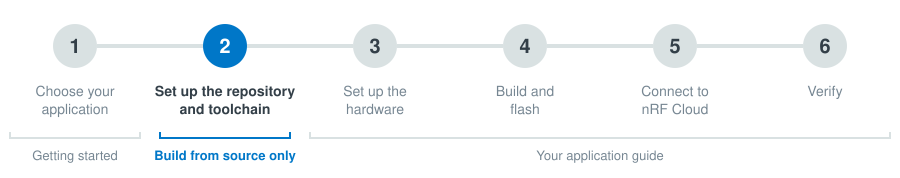

# Set up the repository and toolchain

This page is step 2 of [Getting started](index.md). It sets up everything you need to build the applications from the command line. Skip it if you flash pre-built firmware.



1. Install nRF Util by following the instructions in the [nRF Util documentation](https://docs.nordicsemi.com/bundle/nrfutil/page/guides/installing.html), if you have not done so yet.

1. Install the SDK manager and device commands:

    ```shell
    nrfutil install sdk-manager device
    ```

1. Install the nRF Connect SDK toolchain:

    ```shell
    nrfutil sdk-manager toolchain install --ncs-version v3.5.0-preview2
    ```

1. Start the toolchain shell. All `west` commands in this guide and in the application guides run inside this shell:

    ```shell
    nrfutil sdk-manager toolchain launch --ncs-version v3.5.0-preview2 --shell
    ```

1. From the toolchain shell, create a workspace folder named `smha-workspace` and download the nRF Connect SDK modules into it:

    ```shell
    west init -m https://github.com/nrfconnect/ncs-serial-modem-host-applications --mr main smha-workspace
    cd smha-workspace/project
    west update
    ```

    `west update` downloads the nRF Connect SDK and all its modules and can take a while.

When you come back later, start the toolchain shell again (step 2.4) and go to `smha-workspace/project` before you run `west` commands.

---

**Previous:** [Step 1: Choose your application](index.md) | **Next:** step 3 in your application guide, [PPP on an nRF54 DK](ppp-nrf54.md), [PPP on the nRF93M1 DK](ppp-nrf93m1.md), [nRF93M1 AT](93m1-at.md), or [nRF91 AT on an nRF54LM20B DK](91m1-at.md)
